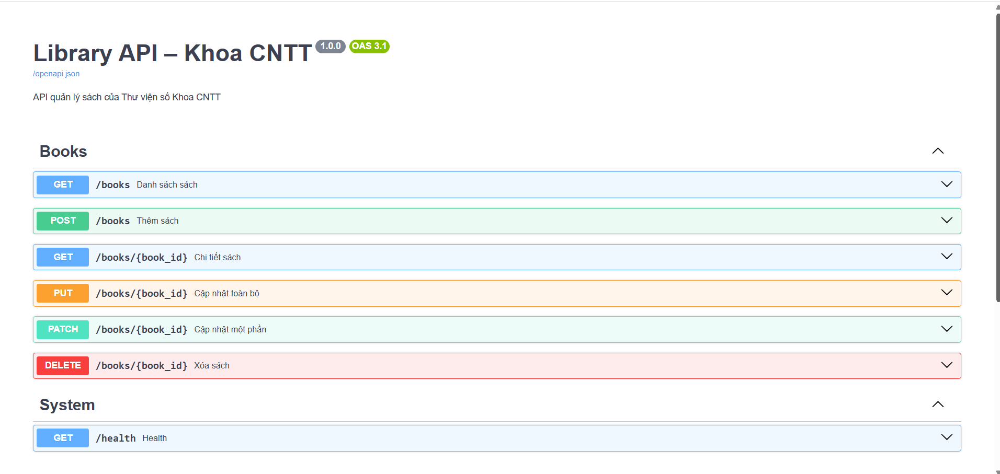
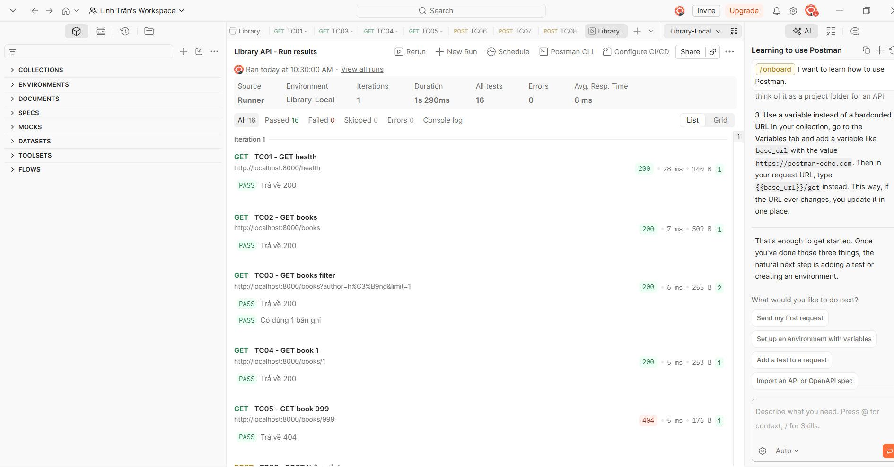

# Library API – Khoa CNTT

API quản lý sách của Thư viện số Khoa CNTT, xây dựng bằng FastAPI.

## Cài đặt và chạy

```bash
python3 -m venv .venv
source .venv/bin/activate
pip install -r requirements.txt
uvicorn app.main:app --reload
```

Mở http://127.0.0.1:8000/docs để xem Swagger UI.

## Các endpoint

| Phương thức | Đường dẫn | Mô tả |
|---|---|---|
| GET | /health | Kiểm tra trạng thái |
| GET | /books | Danh sách sách (q, author, skip, limit) |
| GET | /books/{id} | Chi tiết một cuốn sách |
| POST | /books | Thêm sách (201, 409 trùng ISBN, 422 dữ liệu sai) |
| PUT | /books/{id} | Cập nhật toàn bộ |
| PATCH | /books/{id} | Cập nhật một phần |
| DELETE | /books/{id} | Xóa sách (204) |

## Chạy test

1. Import `postman/Library-API.postman_collection.json` và `postman/Library-Local.postman_environment.json` vào Postman.
2. Chọn environment **Library-Local**, khởi động lại server để dữ liệu sạch.
3. Chạy Collection Runner (Functional): 12 request, 16 test đều Passed.

## Minh chứng



